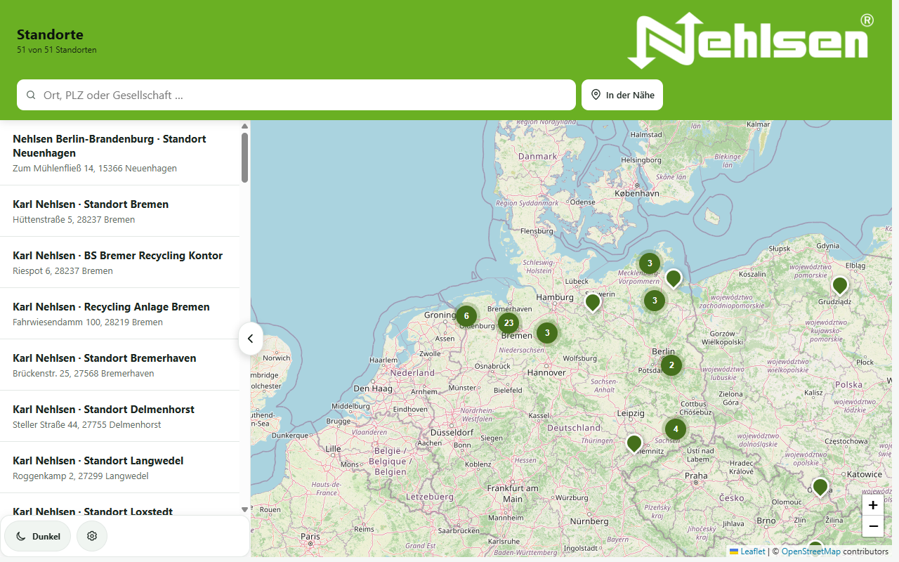
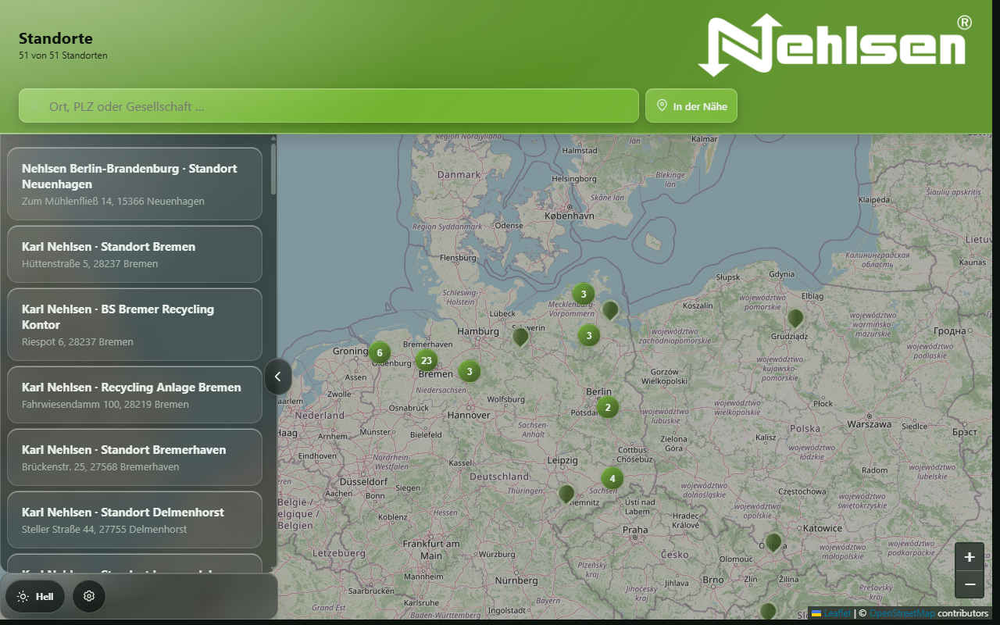
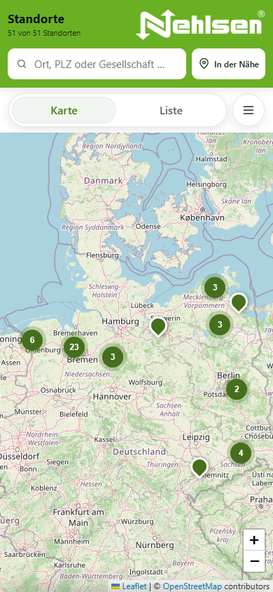
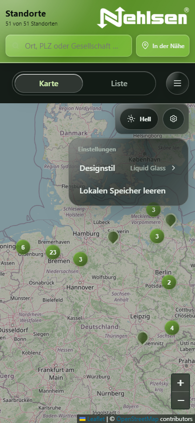
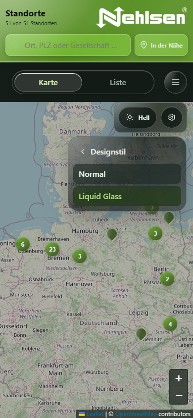

# Nehlsen Standorte

Interne Karten-App für alle Standorte der Nehlsen-Gruppe. Die App läuft als Progressive Web App (PWA) im Browser, lässt sich auf Smartphone und Tablet installieren und ist nach dem ersten Laden auch ohne Netz für die Standortdaten und die Oberfläche nutzbar.

Technisch ist die App bewusst schlank gehalten: reines HTML, CSS und TypeScript ohne Framework. Die Kartenbibliotheken Leaflet und MarkerCluster liegen lokal im Projekt, die App ist also nicht von einem CDN abhängig.

## Inhaltsverzeichnis

- [Screenshots](#screenshots)
- [Funktionen](#funktionen)
- [Schnellstart](#schnellstart)
- [Befehle](#befehle)
- [Projektstruktur](#projektstruktur)
  - [Module in src/](#module-in-src)
- [Entwicklung](#entwicklung)
  - [Quellcode ändern](#quellcode-ändern)
  - [Standortdaten pflegen](#standortdaten-pflegen)
  - [Service Worker und Versionierung](#service-worker-und-versionierung)
  - [Tests](#tests)
- [Offline-Betrieb und Kartenkacheln](#offline-betrieb-und-kartenkacheln)
- [Hinweise](#hinweise)

## Screenshots

### Desktop





### Smartphone

<p align="center">
  
  
  
</p>

## Funktionen

- **Karte und Liste:** Alle Standorte auf einer Karte, zusammengefasst zu Clustern beim Herauszoomen. Auf dem Desktop lässt sich die Standortliste links ein- und ausklappen; auf dem Smartphone wechselt man über die Tabs „Karte“ und „Liste“.
- **Suche:** Filtert nach Ort, PLZ oder Gesellschaft.
- **In der Nähe:** Ermittelt den eigenen Standort (nach Freigabe) und sortiert die Standorte nach Entfernung. Der nächste Standort wird angezeigt.
- **Standortdetails:** Adresse, Telefon, E-Mail und Öffnungszeiten. Das Detailfenster ist nicht modal, die Karte bleibt also bedienbar.
- **Einstellungsrad:**
  - *Designstil:* Normal oder Liquid Glass (Untermenü).
  - *Lokalen Speicher leeren:* Entfernt gespeicherte Einstellungen und alle Caches des Service Workers und lädt die Seite komplett neu, wie Strg+F5.
- **Hell- und Dunkelmodus:** Über den Schalter neben dem Einstellungsrad. Die Auswahl wird gespeichert.
- **Sprache:** Die Beschriftungen des Einstellungsrads folgen der Systemsprache (Deutsch, sonst Englisch).
- **Koordinaten-Werkzeug:** Hilfsseite zum Prüfen und Korrigieren von Koordinaten (`koordinaten-werkzeug.html`).

## Schnellstart

Voraussetzungen: [Node.js](https://nodejs.org/) (aktuelle LTS-Version; getestet mit Node.js 24) und npm.

```sh
npm ci
npm run serve
```

Danach ist die App unter <http://127.0.0.1:4173/> erreichbar, das Koordinaten-Werkzeug unter <http://127.0.0.1:4173/koordinaten-werkzeug.html>.

## Befehle

| Befehl | Zweck |
| --- | --- |
| `npm ci` | Installiert die exakten Abhängigkeiten aus `package-lock.json`. |
| `npm run build` | Kompiliert `src/` nach `js/` und kopiert Leaflet/MarkerCluster nach `vendor/`. |
| `npm test` | Führt den Build aus und anschließend alle Tests. |
| `npm run serve` | Startet den lokalen Webserver auf Port 4173 (über die Umgebungsvariable `PORT` änderbar). |

## Projektstruktur

```text
.
├── index.html                 Hauptseite: Karte, Liste, Einstellungen
├── koordinaten-werkzeug.html  Hilfswerkzeug für Koordinaten
├── standorte.json             Gemeinsame Standortdaten (App und Werkzeug)
├── sw.js                      Service Worker (Offline-Cache, Versionsnummer VERSION)
├── manifest.webmanifest       PWA-Manifest für die Installation auf dem Gerät
├── src/                       TypeScript-Quellen (Einstieg app.ts, Module in Unterordnern)
├── js/                        Kompiliertes JavaScript (von npm run build erzeugt)
├── css/                       Styles für App und Werkzeug
├── vendor/                    Leaflet und MarkerCluster (von npm run build kopiert)
├── assets/, icons/            Logo und App-Icons
├── scripts/                   Hilfsskripte (siehe scripts/README.md)
├── tests/                     Automatisierte Tests
└── docs/screenshots/          Bilder für diese Datei
```

### Module in src/

Die App ist nach Aufgaben in Ordner aufgeteilt. `app.ts` ist nur der Einstieg: Er ruft die Init-Funktionen der Module in fester Reihenfolge auf. Jedes Modul exportiert Funktionen statt eigenen Zustand beim Laden zu erzeugen; gemeinsame Daten liegen in `data/app-state.ts`.

| Datei | Aufgabe |
| --- | --- |
| `app.ts` | Einstiegspunkt: startet alle Module in der richtigen Reihenfolge |
| `domain.ts` | Reine Logik ohne DOM: Entfernung, Suche, Datenprüfung, HTML-Escaping |
| `coordinate-tool.ts` | Koordinaten-Werkzeug (eigenständige Seite, unabhängig von der App) |
| `core/dom.ts` | `byId`: Pflichtelemente sicher abrufen |
| `core/storage.ts` | Lokale Einstellungen lesen, speichern und löschen |
| `core/toast.ts` | Kurze Hinweismeldungen |
| `core/viewport.ts` | Erkennung Desktop / Smartphone |
| `i18n/strings.ts` | Texte des Einstellungsrads, Spracherkennung |
| `settings/settings-menu.ts` | Einstellungsrad, Untermenüs, mobiles Menü |
| `settings/theme.ts` | Farbmodus Hell, Dunkel oder System |
| `settings/design.ts` | Designstil Normal oder Liquid Glass |
| `settings/clear-data.ts` | Lokalen Speicher leeren und neu laden |
| `map/map-view.ts` | Leaflet-Karte, Kacheln, Marker-Cluster |
| `map/markers.ts` | Pins erzeugen und in einer Registry ablegen |
| `map/keep-marker-visible.ts` | Gewählten Pin vom Detailfenster frei halten |
| `map/user-location.ts` | Schaltfläche „In der Nähe“ und Standort des Nutzers |
| `detail/sheet.ts` | Detailfenster öffnen, schließen, Fokus verwalten |
| `detail/sheet-template.ts` | HTML des Detailfensters (mit Icons) |
| `detail/sheet-gesture.ts` | Auf dem Smartphone nach unten wischen zum Schließen |
| `list/location-list.ts` | Standortliste, Suche und Trefferzähler |
| `views/tabs.ts` | Umschalten Karte / Liste, Tastaturbedienung |
| `views/layout.ts` | Desktop-Standortliste ein- und ausklappen |
| `views/escape-key.ts` | Escape-Taste schließt Menüs und Detailfenster |
| `data/app-state.ts` | Gemeinsamer Zustand: Standorte, Nutzerposition, Suchbegriff |
| `data/locations.ts` | `standorte.json` laden und anzeigen |
| `pwa/service-worker.ts` | Registrierung des Service Workers |

Im Build entstehen daraus gleichnamige Dateien unter `js/` (z. B. `js/detail/sheet.js`).

## Entwicklung

### Quellcode ändern

Bearbeitet werden immer die Dateien in `src/` bzw. `css/` und `index.html`. Die Dateien in `js/` und `vendor/` sind generiert und werden bei jedem Build überschrieben.

Nach Änderungen an `src/` oder an den Kartenskripten:

```sh
npm run build
```

Die aktualisierten Dateien aus `js/` (und ggf. `vendor/`) gehören mit in den Commit.

### Standortdaten pflegen

Die Standorte stehen in `standorte.json` und werden von App und Koordinaten-Werkzeug gemeinsam genutzt. Vor dem Commit `npm test` ausführen: Die Tests prüfen unter anderem die Datenstruktur, doppelte IDs und ungültige Koordinaten (`validateLocations` in `src/domain.ts`).

### Service Worker und Versionierung

Der Service Worker (`sw.js`) speichert die Kern-Dateien der App lokal. Installierte Apps erhalten Änderungen nur, wenn die Versionsnummer `VERSION` in `sw.js` erhöht wird. Das ist nötig, sobald eine Datei aus der Liste `CORE` geändert wurde (z. B. `css/app.css`, `js/app.js`, `index.html`, `standorte.json`). Neue Module unter `js/` müssen zusätzlich in `CORE` eingetragen werden; `tests/project.test.mjs` prüft das.

### Tests

`npm test` führt drei Testdateien aus:

- `tests/domain.test.mjs`: Logik für Entfernung, Suche und Datenvalidierung.
- `tests/interaction.test.mjs`: Bedienabläufe der App (Listen, Detailfenster, Einstellungsrad, Speicher leeren) mit simulierten DOM-Elementen.
- `tests/project.test.mjs`: Prüft Projektstruktur, Styles, Service Worker und Texte des Quelltexts. Diese Tests vergleichen Quelltext per Regex; dafür werden alle Module aus `src/` bzw. `js/` gemeinsam gelesen. Wer CSS-Regeln oder HTML-Attribute umbenennt, muss die passenden Erwartungen dort anpassen.

Zusätzlich gibt es einen Browser-Test für die echte Oberfläche: siehe [scripts/README.md](scripts/README.md).

## Offline-Betrieb und Kartenkacheln

Beim ersten Aufruf installiert sich der Service Worker und lädt die Oberfläche, die Standortdaten und die Kartenbibliotheken vorab. Danach funktioniert die App auch ohne Netz.

Kartenkacheln kommen von OpenStreetMap (`https://tile.openstreetmap.org`). Sie werden nur beim normalen Benutzen der Karte nachgeladen und begrenzt lokal zwischengespeichert. Eine vollständige Karte ist offline deshalb nicht garantiert. Die Nutzung muss der [OpenStreetMap-Kachelrichtlinie](https://operations.osmfoundation.org/policies/tiles/) entsprechen.

## Hinweise

- Koordinaten und Öffnungszeiten vor dem produktiven Einsatz fachlich prüfen.
- Die Anwendung hat keine Anmeldung und keine Zugriffskontrolle. Eine interne Bezeichnung ersetzt keine geschützte Bereitstellung.
- Der Service Worker und die Standortfreigabe funktionieren nur über `https://` oder auf `localhost`.
